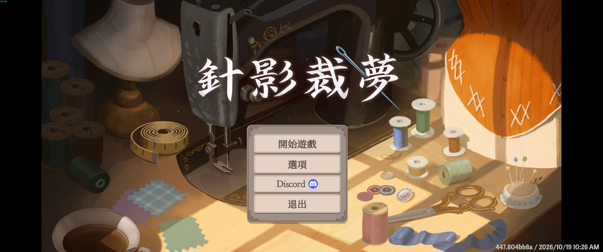
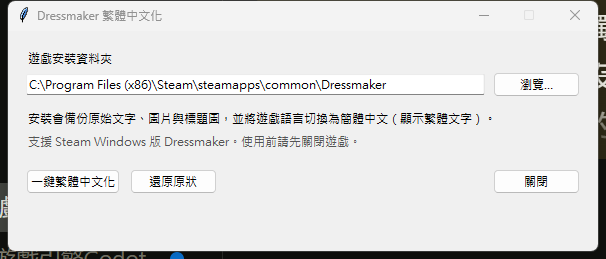
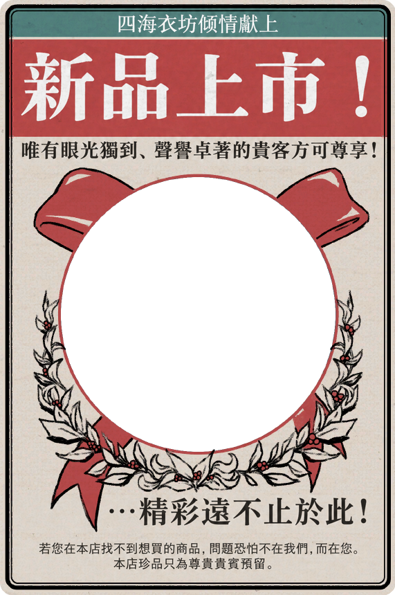

# Dressmaker 繁體中文化｜針影裁夢

讓 Steam Windows 版《Dressmaker》的介面、教學、對話與部分圖片以繁體中文呈現。提供一鍵安裝、原檔備份與還原工具，玩家不需要安裝 Python。

**[下載安裝器](https://github.com/koehhian/dressmaker-zh-hant/releases/latest) · [安裝與還原](docs/USER_GUIDE.md) · [回報問題](https://github.com/koehhian/dressmaker-zh-hant/issues) · [開發與更新](localization/zh-Hant/WORKFLOW.md)**



*實際遊戲畫面，拍攝於 2026-10-20；畫面右下為遊戲顯示的版本資訊。*

## 可以獲得什麼

| 內容 | 範圍 |
| --- | --- |
| 繁體文字 | 5,398 筆，涵蓋內容、教學、對話及介面 4 個語言表 |
| 圖片中文化 | 遊戲標題、宣傳單、報紙標題；另處理主選單實際載入的內建標題圖 |
| 安裝工具 | 自動尋找 Steam 遊戲位置，可手動選擇資料夾 |
| 備份與還原 | 備份原始檔、同步 Addressables CRC、還原遊戲語言偏好 |

文字以 OpenCC 臺灣用語轉換為基礎，再修訂用語；目前未宣稱逐句完成人工審校。歡迎附上畫面與上下文回報錯字、用詞或排版問題。

## 三步驟開始

1. 自行安裝 Steam Windows 版 [Dressmaker](https://store.steampowered.com/app/4019220/)，並關閉遊戲。
2. 到 [Releases](https://github.com/koehhian/dressmaker-zh-hant/releases/latest) 下載 `DressmakerZHant.exe`，或下載 Windows ZIP 後解壓縮。
3. 執行安裝器，確認遊戲資料夾，按「一鍵繁體中文化」，完成後從 Steam 啟動遊戲。

**安裝器會把遊戲語言切換為「簡體中文」，以載入替換後的繁體內容。這是正常行為。** 移除補丁時，關閉遊戲，再開啟同一工具按「還原原狀」。



*既有安裝器的實際視窗；安裝及還原按鈕位於左下。更多說明見[使用指南](docs/USER_GUIDE.md)。*

## 圖片中文化預覽

以下為補丁使用的替換圖片，並非遊戲內截圖。

| 標題 | 宣傳單 | 報紙標題 |
| --- | --- | --- |
|  |  |  |

## 支援範圍與已知限制

- 支援 Steam Windows 版，Steam App ID `4019220`。本機測試基準為 Steam build `26043449`；不保證未測試的其他版本、macOS 或 Linux 相容。
- 補丁基準為 2026-10-20。2026-11-06 重新執行的驗證與安裝器 SHA-256 見 [驗證紀錄](docs/VALIDATION.md)。
- 遊戲更新新增的字串可能維持簡中；移除字串、改變語言表或圖片結構時，工具可能拒絕安裝，需更新補丁。詳見[更新流程](localization/zh-Hant/WORKFLOW.md)。
- 保留遊戲目錄內的 `.zh-hant-backup` 與 `.zh-hant-state.json`，才能使用工具還原。發生不相容時，先用 Steam 驗證遊戲檔案。
- 本工具修改本機遊戲檔案。請勿同時使用會修改相同語言包、圖片或 Addressables 目錄的其他補丁。

## 給開發者與校對者

翻譯主檔是 `localization/zh-Hant/translations.csv`，以 `(table, id)` 對應字串。原始碼位於 `localization/zh-Hant/tools/`。

```powershell
py -m pip install -r requirements.txt
py -m PyInstaller --noconfirm --clean .\localization\zh-Hant\tools\DressmakerZHant.spec
```

輸出為 `dist/DressmakerZHant.exe`。維護流程、更新差異比對與遊戲副本驗證見 [WORKFLOW.md](localization/zh-Hant/WORKFLOW.md)，貢獻方式見 [CONTRIBUTING.md](CONTRIBUTING.md)。

## 權利與致謝

本專案為非官方玩家補丁，與遊戲開發商、發行商或 Steam 無隸屬關係。需自行持有並安裝原遊戲；專案不提供遊戲本體、原始資產包、存檔或個人設定。

工具原始碼採 MIT 授權，範圍見 [LICENSE](LICENSE)。翻譯含原遊戲內容的衍生文字，修改圖片與遊戲截圖亦涉及原遊戲素材；原有內容的權利仍屬各權利人，未納入工具的 MIT 授權。使用 UnityPy、OpenCC 與 PyInstaller，詳見 [THIRD_PARTY_NOTICES.md](THIRD_PARTY_NOTICES.md)。
