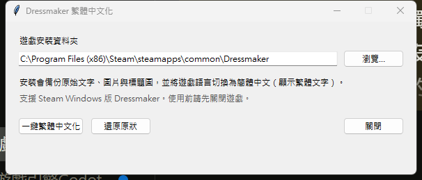
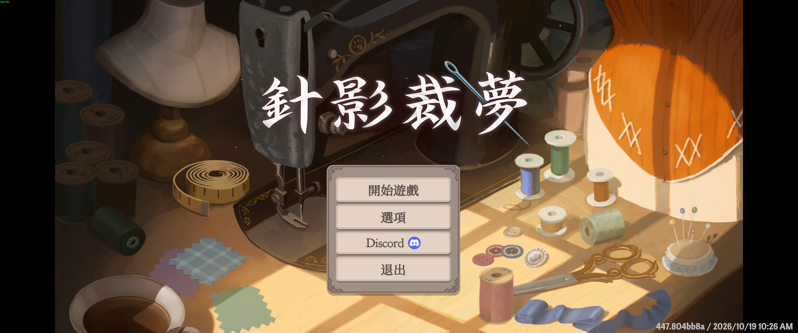

# 安裝、還原與疑難排解

## 下載前確認

本次驗證適用 **Steam Windows 版 Dressmaker，Steam build ID 26043449**（2026-11-06 以本機已安裝版本測試）。其他 build 尚未驗證，遊戲更新後請重新確認補丁相容性。請從本專案 Releases 下載 `DressmakerZHant.exe` 或 Windows ZIP；GitHub 的「Code → Download ZIP」是開發用儲存庫快照；一般玩家請優先下載 Releases 的安裝器或 Windows ZIP。安裝器不需要 Python，尚未使用數位憑證簽署。

從 Steam 遊戲庫右鍵遊戲 → 管理 → 瀏覽本機檔案，即可找到安裝位置。預設常見位置為 `C:\Program Files (x86)\Steam\steamapps\common\Dressmaker`，選擇包含 `Dressmaker.exe` 的資料夾。

## 安裝

1. 關閉遊戲，等待 Steam 更新結束。
2. 執行 `DressmakerZHant.exe`，確認「遊戲安裝資料夾」，必要時按「瀏覽…」更換。
3. 按「一鍵繁體中文化」，等待完成訊息。若顯示失敗，記下完整訊息，勿連續強制重試。
4. 從 Steam 啟動遊戲。主選單應顯示「針影裁夢」「開始遊戲」「選項」。



工具會在原遊戲旁備份文字包、圖片包、目錄及內建標題串流，並切換語言偏好。選項仍顯示簡體中文，畫面內容則是繁體；不要為此切回英文。



## 還原

1. 關閉遊戲。
2. 執行同一個安裝器，指向原遊戲資料夾。
3. 按「還原原狀」，等待完成訊息，再從 Steam 啟動。

工具會核對備份雜湊後還原，並恢復原本的語言偏好。請保留 `.zh-hant-backup`、`.zh-hant-state.json` 及 `%LOCALAPPDATA%\DressmakerZHant` 的備份；不要手動刪除來繞過檢查。

## Steam 更新之後

先關閉遊戲並驗證遊戲檔案完整性，再使用相容的新補丁。若只想回到官方版，完成 Steam 驗證後不必重新安裝補丁。更新後工具可能拒絕還原舊備份，這是避免覆蓋新版檔案的檢查；不要把舊備份手動蓋回新版本。

| 狀況 | 處理方式 |
| --- | --- |
| 找不到遊戲 | 選擇包含 `Dressmaker.exe` 的資料夾；非 `Dressmaker_Data` |
| 權限不足 | 確認遊戲已關閉且有權寫入安裝資料夾；必要時以系統管理員執行 |
| ID 數不符、覆蓋率檢查失敗 | 遊戲資源可能更新，請附版本與錯誤訊息回報，等待主檔更新 |
| 語言檔已更新或修改、CRC 不符 | 關閉遊戲，用 Steam 驗證後重新安裝相容補丁 |
| 找不到備份、備份校驗失敗 | 使用 Steam 驗證回官方版；不要強制套用未知備份 |
| 部分新增文字仍是簡體 | 主檔尚未涵蓋新字串，請附畫面與出現位置回報 |

## 檔案完整性

Releases 提供 `SHA256SUMS.txt`。可在 PowerShell 執行下列命令，與公布的雜湊逐字比對：

```powershell
Get-FileHash .\DressmakerZHant.exe -Algorithm SHA256
```

## 回報問題

請到 GitHub Issues 提供：Steam build ID、補丁版本、安裝或還原時的完整錯誤、可重現步驟，以及裁掉個人資訊的遊戲畫面。打字錯誤請提供原句、建議修正與所在場景。不要上傳完整遊戲檔案或私人存檔。
